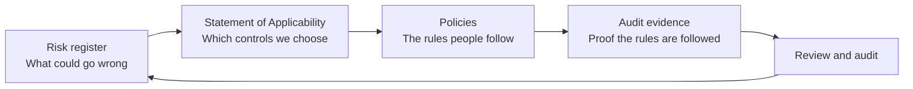

# ISMS Starter Kit: ISO 27001:2022

A small-company information security management system (ISMS) built from scratch for a fictional company: scope, policy, risk register, Statement of Applicability, policies and an audit evidence checklist, all linked to each other.

> **Havelmetrics GmbH is fictional.** I invented the company so I could practise real GRC work (governance, risk and compliance) end to end. This is a learning project. It is not a certified ISMS and not legal advice.

## What this project shows

- How to take a company from "we have some security habits" to a structured ISO 27001-style ISMS
- How a **risk** leads to a **control**, a control leads to a **policy rule**, and a rule leads to **evidence** that an auditor can check
- Clear writing for a small team with no dedicated security staff: short policies, named owners, real dates

## The company

Havelmetrics is a Berlin B2B software company with about 40 employees. It sells StoreSight, a cloud dashboard that turns sales data into daily reports for retail chains. It runs on Microsoft Azure and Azure SQL, uses GitHub and Microsoft 365 with Entra ID, and has one part-time IT administrator. Two enterprise customers will only sign with ISO 27001 certification, and GDPR applies because the product holds personal data. Full details: [00-company-profile.md](00-company-profile.md).

## How the pieces connect

Every link in the chain is traceable: policies list the controls and risks they cover, and the evidence checklist uses the same control numbers and due dates.

## Repository map

| Folder | What is inside |
|---|---|
| [00-company-profile.md](00-company-profile.md) | The fictional company: size, systems, customers, constraints |
| [01-scope-policy](01-scope-policy) | ISMS scope and the information security policy |
| [02-risk](02-risk) | Risk assessment method (5x5) and the risk register (30 risks) |
| [03-controls](03-controls) | Statement of Applicability covering all 93 ISO 27001:2022 Annex A controls |
| [04-policies](04-policies) | Access control policy and incident response policy |
| [05-audit](05-audit) | Audit evidence checklist: what an auditor would ask for, and the proof |

## The numbers

- **30 risks:** 4 Critical, 12 High, 12 Medium, 2 Low. 28 are to be reduced, 2 are accepted.
- **93 controls assessed:** 84 apply, 9 are excluded with a written reason.
- **35 evidence items:** 14 ISO 27001 clause requirements and 21 Annex A control areas, each with an owner, a location and a ready-by date.
- **Critical risks are due first:** 18 November 2026. High risks are due 17 January 2027.

## Example: following one risk from start to finish

1. **Risk R07 (High, 12):** people who leave the company keep access to its systems.
2. **Controls:** 5.16 identity management, 5.18 access rights, 6.5 responsibilities after leaving.
3. **Policy rule:** in the [access control policy](04-policies/access-control-policy.md), leavers lose all access on their last working day, using a checklist that covers Microsoft 365, Azure, GitHub, the support tool and work email on personal phones.
4. **Evidence (E16):** completed leaver checklists for the last three leavers, plus the Entra ID log showing the account was disabled.

## Decisions I made, and why

- **Phishing is the top risk (R01, Critical, 4 x 4 = 16).** One stolen Microsoft 365 account gives access to email and files, staff are untrained and MFA is only partly enforced.
- **Two low risks are accepted, not fixed (R21, R28).** For a company of 40, extra controls for these would cost more than the risk is worth.
- **Nine controls are excluded.** For example, the company has no on-premises servers, so physical equipment controls do not apply. Each exclusion has a reason in the Statement of Applicability.
- **Breach reporting depends on the role.** For its customers' data, Havelmetrics is a processor and tells the customer, who decides on notifying the authority. For its own staff data, it is the controller and has 72 hours to notify.
- **NIS2 is treated as an open question (R24).** Whether it applies has not been assessed, so the plan includes an assessment and aligns the incident process with its reporting times in case it does.

## Standards used

ISO/IEC 27001:2022 (requirements and Annex A), ISO/IEC 27002:2022 (control guidance), and the EU regulations GDPR and NIS2 as the legal context.

## Status and next steps

- [x] Company profile, scope and information security policy
- [x] Risk assessment method and risk register
- [x] Statement of Applicability
- [x] Access control and incident response policies
- [x] Audit evidence checklist
- [ ] Mapping of controls to NIST CSF and DORA
- [ ] Third-party (vendor) risk assessment for the three key suppliers
- [ ] GDPR records: processing activities and data subject requests

## How this was built

I wrote the structure and made the decisions, and used an AI assistant (Claude) to speed up drafting. I reviewed the output against the standard and my company profile and corrected it, and I can explain every choice. Names, contact details and tool names in the documents are examples.

## About me

Fahad Maqbool, final-year BSc Computing student at Arden University Berlin, focusing on GRC and information security.
[LinkedIn](https://www.linkedin.com/in/fahad-maqbool-9156b01b2/)
